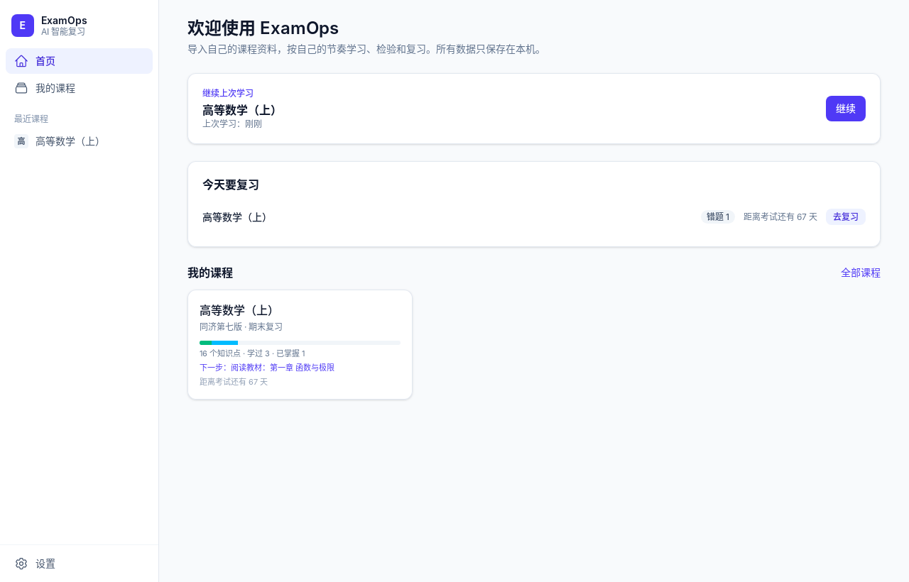

# 🎓 ExamOps

<div align="center">

**基于个人学习资料的本地优先 AI 智能学习与备考工作台**

*Local-First AI Study & Exam Preparation Assistant Powered by Tauri 2 + Rust + Vue 3*

[](https://github.com/zengxiaofeng233/ExamOps/releases)
[](LICENSE)
[](docs/INSTALL.md)
[](https://tauri.app/)
[](https://www.rust-lang.org/)
[](https://vuejs.org/)
[](https://tailwindcss.com/)

[功能特性](#-核心特性) • [界面预览](#-界面预览) • [快速上手](#-快速上手) • [系统架构](#-系统架构) • [开发者指南](#-开发者指南) • [完整文档](#-文档导航)

</div>

---

## 📖 简介

**ExamOps** 是一款专为学生和备考人群设计的**单用户、本地运行**的智能复习软件。

你只需导入自己的教材、讲义、PPT、笔记或网课链接，通过自己配置的 AI 大模型，即可实现**按章节互动精讲、有据可查的精准答疑、全题型智能自测、以及基于艾宾浩斯曲线的自适应复习调度**。

与市面上的在线学习平台不同，ExamOps 坚持 **Local-First（本地优先）与隐私优先** 理念：**无需注册账号、数据绝不上传云端，所有教材副本、笔记和学习足迹全量保存在本机 SQLite 数据库中**。

### 💡 为什么选择 ExamOps？

- 🔒 **100% 隐私与离线可用**：所有学习资料保存在本机，配合本地模型（如 Ollama / LM Studio）可实现 100% 离线使用。
- 🎯 **杜绝幻觉，严格溯源**：回答严格基于你的材料，清晰标注【教材】【补充】【推导】，点击即可跳回原书对应页码和段落。
- 🔄 **闭环式学习工作流**：从资料导入、知识点抽取、路径规划、AI 分段精讲，到测验检验、错题归纳与科学复习，一站搞定。
- 🔑 **BYOK（自带模型，零厂商锁定）**：支持任何兼容 OpenAI 接口的大模型（DeepSeek、通义千问、智谱 GLM、Kimi、OpenAI 等），API 密钥受 Windows 凭据管理器系统级硬件加密保护。
- 📑 **全格式深度结构化与本地 OCR**：支持 PDF（含扫描件本地 RapidOCR 识别）、Word、PPT、Markdown、TXT，自动剥离页眉页脚、精准保留章节层级与图表。

---

## ✨ 核心特性

### 1. 📚 资料中心与智能结构化 (Document Engine)
- **多格式支持**：一键导入 PDF（文字版及扫描版）、Word (`.docx`)、PowerPoint (`.pptx`)、Markdown 与 TXT。
- **本地高精度 OCR**：内置随安装包分发的轻量 RapidOCR 引擎，无缝识别扫描件与插图文字，计算全在本地完成。
- **章节与图表还原**：智能识别 PDF 书签、Word 样式、PPT 页面标题及层级编号；自动提取高清插图并保留原文排版位置。
- **全文毫秒级检索**：内置 SQLite FTS5 + `unicode61` 中文分词索引，支持原页面对照预览与高亮定位。

### 2. 🤖 三大模式 AI 精讲与网课伴学 (Tutor Engine)
- **图片讲题与手写答案识别**：AI 学习和 AI 问答均支持选择、拖拽、粘贴 JPG / PNG / WebP，每条消息最多 4 张、每张 5 MB；可只发图片，图片随对话保存在本机，并发送给你配置的视觉模型用于讲解、点评和后续追问。
- **三种学习模式**：
  - **从零学习**：按章节切分为 ~1500 字的渐进段落，逐段深度剖析，支持追问、案例拓展与实时测验。
  - **正常复习**：启发式主动回忆引导，先让你尝试复述关键结论，再指出漏洞与补充推导。
  - **考前冲刺**：直击高频核心考点与典型题型，快速扫清盲区。
- **严格来源溯源**：流式生成中明确区分【教材原文】、【背景补充】与【逻辑推导】，每个论断均附带资料位置锚点。
- **B 站网课伴学**：支持扫码登录读取高清分 P 字幕或平台 AI 总结，生成网课专属讲解，与教材资料双向对照。
- **上下文联动笔记**：笔记支持 Markdown 与 KaTeX 数学公式渲染，并与教材章节、具体页码和知识点深度绑定。

### 3. 🗺️ 知识图谱与动态学习路径 (Path Engine)
- **智能知识点抽取**：支持从目录快速生成或利用 AI 深度提炼，自动判定重要度（一般 / 重要 / 核心考点）。
- **个性化路径编排**：提供按章节生成、AI 定制规划（如“考前两周冲刺前四章”）或空白路径三种模式，支持拖拽排序与任务插入。
- **状态追踪**：严谨区分“未学”、“学过”与“已掌握”（只有通过测验且正确率 $\ge 80\%$ 才能标为已掌握）。

### 4. 📝 全题型智能测验与精准批改 (Assessment Engine)
- **五大多样化题型**：单选题、判断题、简答题、自由复述题、情景应用题，题目 100% 依凭导入教材自动生成。
- **双轨批改机制**：
  - **客观题**：本地瞬间判分，解析详实。
  - **主观题**：AI 对照教材采分点严格批改，提示词级数据隔离防止注入，批改失败支持人工自评兜底。
- **小测自由定制**：可自选知识点、按章节出题、或针对历史错题生成同类变式题。

### 5. ⏳ 艾宾浩斯科学复习调度 (Review & Spaced Repetition)
- **SM-2 间隔复习算法**：根据测验表现（指数移动平均 EMA）计算知识点掌握度，动态安排复习频次（1天 → 3天 → 动态递增）。
- **临考自适应压缩**：录入考试日期后，系统自适应缩短复习间隔，确保所有核心内容在考前至少完整轮转一遍。
- **智能错题本**：低于 60% 分数的题目自动沉淀入错题库，重测达标后自动移出，复习建议根据遗忘曲线每日动态更新。

### 6. 🛡️ 存储安全与优雅体验
- **安全密钥保管**：API Key 优先存入 **Windows 凭据管理器**，界面脱敏展示，彻底告别明文泄漏风险。
- **灵活的数据迁移**：应用内置数据盘无缝迁移功能，支持一键更改存储目录并提供完整性校验和旧数据清理保护机制。
- **暗黑模式与流畅动画**：全套适配的深色模式与开屏动画，界面自适应窄屏（最低支持 800×600 布局），长时间沉浸学习更舒适。

---

## 🖼️ 界面预览

| 首页与学习概览 | 资料阅读与原页对照 |
| :---: | :---: |
|  |  |
| **交互式 AI 学习与来源标注** | **智能测验与批改** |
|  |  |

<div align="center">

| 间隔复习、下一步建议与错题本 |
| :---: |
|  |

*(注：截图中的 AI 对话内容基于本地模拟环境 `scripts/mock_ai.py` 生成，实际使用效果取决于您配置的 AI 模型。)*

</div>

---

## 🚀 快速上手

### 面向普通使用者

1. **下载安装**：前往 [Releases 页面](https://github.com/zengxiaofeng233/ExamOps/releases) 下载最新版本的 `ExamOps_<版本>_x64-setup.exe`。
   - 安装包内置 WebView2、文档解析程序及 RapidOCR 离线模型，**无需安装 Python、Node.js 等任何开发环境**。
   - 默认安装到当前用户目录，**无需管理员权限**。
2. **配置 AI 模型**：
   - 打开应用，进入 **设置 → AI 模型 → 添加模型**。
   - 选择预设（DeepSeek、OpenAI、通义千问、智谱、Kimi、硅基流动或本地 Ollama）并填入你的 API Key。
   - 点击“测试连接”，确认成功后设为默认。
3. **开启学习之旅**：
   - **创建课程**：在“我的课程”中新建课程，设定考试目标日期。
   - **导入资料**：资料保存后进入后台队列，已识别页面可提前阅读；整份解析完成后开放章节、搜索与 AI。关闭软件会停止识别，下次打开自动续扫。
   - **识别加速**：PDF 使用区域 OCR、自适应分辨率和按页缓存；CPU 并发数随可用内存调整。设置 → 通用 → 资料识别可切换显卡加速，Windows 使用 DirectML，不可用时回退 CPU。
   - **生成路径**：提取知识点并一键生成学习路径。
   - **开始互动**：点击进入“AI 学习”，享受精准、严谨的伴学体验！

详细说明请参考：📖 [安装与首次使用指南](docs/INSTALL.md) 与 📘 [全功能使用指南](docs/USER_GUIDE.md)。

---

## 🏗️ 系统架构

ExamOps 采用分层解耦的现代化混合桌面应用架构：

```
┌──────────────────────────────────────────────────────────────┐
│                  WebView2 桌面交互层 (Vue 3)                  │
│   课程 · 资料阅读 · 知识图谱 · 学习路径 · AI 伴学 · 测验 · 复习    │
└──────────────────────────────┬───────────────────────────────┘
                               │ Tauri IPC (强类型契约)
┌──────────────────────────────▼───────────────────────────────┐
│                     Rust 高性能核心层                         │
│  ├── Document Engine: 资料版本管理、分块切片、引用映射         │
│  ├── Search Engine: SQLite FTS5 中文全文检索                 │
│  ├── AI Gateway: SSE 流式解析、上下文预算、错误重试、凭据保护    │
│  ├── Context Engine: Full / RAG / Auto 动态策略             │
│  ├── Tutor Engine: 三大模式分段教学、溯源锚点注入              │
│  ├── Assessment Engine: 5类题型出题、结构校验、主客观双轨批改   │
│  ├── Review & Mastery: SM-2 遗忘曲线调度、掌握度衰减模型      │
│  └── Storage Engine: SQLite (WAL 模式) + 自动化版本迁移       │
└──────────────┬───────────────────────────────┬───────────────┘
               │ 进程间 JSON RPC 通信           │ HTTPS (仅在调用 AI 时)
      ┌────────▼─────────┐             ┌───────▼──────────────┐
      │  Python Sidecar  │             │   用户自有 AI 服务    │
      │  - RapidOCR 本地 │             │   (DeepSeek/OpenAI/  │
      │  - PyMuPDF/Word  │             │    Ollama 等兼容端点) │
      │  - 章节智能推断   │             └──────────────────────┘
      └──────────────────┘
```

### 技术栈选型

| 模块 | 核心技术 | 优势 |
| :--- | :--- | :--- |
| **桌面运行时** | [Tauri 2](https://tauri.app/) (WebView2) | 超轻量资源占用、秒级冷启动、原生安全性 |
| **前端交互** | [Vue 3](https://vuejs.org/) + [TypeScript](https://www.typescriptlang.org/) + [Tailwind CSS 4](https://tailwindcss.com/) + [Pinia](https://pinia.vuejs.org/) | 强类型开发、响应式状态、现代化流畅 UI |
| **核心业务** | [Rust](https://www.rust-lang.org/) (Tokio + Rusqlite + Reqwest) | 内存安全、零成本抽象、无 GC 停顿、高并发 |
| **本地数据库** | [SQLite](https://www.sqlite.org/) (WAL 模式) + FTS5 | 进程级高并发、中日韩分词全文检索、稳健持久化 |
| **文档处理 Sidecar** | Python 3.12 (PyInstaller + RapidOCR + pypdfium2) | 离线 OCR、复杂版式识别，随软件打包为独立二进制 |
| **安全存储** | Windows Credential Manager | 系统级安全凭据保管，防止 API 密钥明文泄露 |

---

## 💻 开发者指南

### 环境准备

- **操作系统**：Windows 10 / 11（64 位）
- **Node.js**：20.x 或更高版本
- **Rust**：Stable 工具链（包含 MSVC 构建工具）
- **Python**：3.12 x64（仅构建 Sidecar 需要）

### 常用开发命令

```bash
# 1. 克隆代码仓库并安装前端依赖
git clone https://github.com/zengxiaofeng233/ExamOps.git
cd ExamOps
npm install

# 2. 启动开发模式（首次会自动创建 python-sidecar/venv 并打包 Sidecar）
npm run tauri:dev

# 若仅改动前端或 Rust 代码，可跳过 Sidecar 重新编译：
npm run tauri -- dev
```

### 零成本调试（本地模拟 AI 服务）

开发与调试无需消耗真实 Token！ExamOps 内置了本地 Mock AI 服务：

```bash
# 启动本地模拟服务（监听 http://127.0.0.1:18080/v1）
python scripts/mock_ai.py
```

在 ExamOps 设置中添加模型：Base URL 设为 `http://127.0.0.1:18080/v1`，API Key 填写任意字符（如 `sk-test`），模型名称填 `mock` 即可畅享完整流程测试，还支持模拟网络中断、429 限流等异常场景。

### 自动化测试与代码规范

提交代码前，请确保各项检查通过：

```bash
# 前端类型检查与单元测试
npx vue-tsc --noEmit && npm test

# Rust 代码格式检查与测试
cd src-tauri && cargo test && cargo clippy --all-targets -- -D warnings

# Python 文档解析单元测试
cd ../python-sidecar && python -m unittest -v
```

### 构建正式安装包

```bash
npm run tauri:build
```
产物将输出至：`src-tauri/target/release/bundle/nsis/ExamOps_<版本>_x64-setup.exe`。

### 应用内更新与签名发布

启动时仍仅检查 GitHub 正式版本。用户点击“下载更新”后显示进度，通过签名校验才可“安装并重启”；安装前需保存编辑内容、等待 AI 回答完成，资料处理期间会阻止安装。下载失败可重试或前往 GitHub 手动下载。下载包暂存在当前进程内，关闭应用后需重新下载，不支持断点续传。

旧版（包括 v0.2.3）需要手动安装一次支持该流程的新版，此后才能使用应用内更新。升级保留原有数据目录，不改变课程、资料、笔记和设置。更新仍是完整安装包，包含 OCR 组件。

发布需要固定的 Tauri 更新签名密钥：公钥位于 `src-tauri/tauri.conf.json`，私钥必须保存在仓库外并备份。GitHub Actions 使用仓库 Secret `TAURI_SIGNING_PRIVATE_KEY`，有密码时另设 `TAURI_SIGNING_PRIVATE_KEY_PASSWORD`。不要重新生成密钥替换已发布版本的公钥，否则旧客户端不能验证后续更新。

本地构建先设置 `TAURI_SIGNING_PRIVATE_KEY`（私钥文件路径或内容）和 `TAURI_SIGNING_PRIVATE_KEY_PASSWORD`（无密码时为空），然后运行 `npm run tauri:build` 和 `python scripts/updater-manifest.py`。发布标签必须为 `v<配置版本号>`。

发布工作流会将 `.exe`、`.exe.sig`、`latest.json` 一起上传到草稿 Release；确认三个文件齐全后再发布。应用按选定版本读取该 Release 的清单，缺少清单或签名校验失败时不会安装。更新签名用于验证更新包，不等同于 Windows Authenticode 代码签名。

---

## 📚 文档导航

项目提供了详尽的工程与设计文档，方便进一步阅读：

| 文档名称 | 核心内容 |
| :--- | :--- |
| 🚀 [安装与首次使用 (INSTALL.md)](docs/INSTALL.md) | 系统硬件要求、完整安装步骤、模型配置方法、数据目录迁移与备份指引 |
| 📘 [全功能使用指南 (USER_GUIDE.md)](docs/USER_GUIDE.md) | 涵盖从课程创建、资料导入、AI 伴学到错题本的详尽功能图文用法 |
| 🏛️ [系统深度架构设计 (ARCHITECTURE.md)](docs/ARCHITECTURE.md) | 七大核心引擎运作机制、数据流动模型与安全防护规范 |
| 🔌 [Tauri 命令参考 (API.md)](docs/API.md) | 前后端通信的全部 IPC 命令接口说明与入参定义 |
| 🧪 [测试体系与验收清单 (TESTING.md)](docs/TESTING.md) | 单元测试、模拟 AI 服务故障注入、断网容灾及极端文件健壮性测试规范 |

---

## 📄 开源许可与致谢

ExamOps 基于 [MIT 许可证](LICENSE) 开源。

- **教学方法论参考**：学习交互设计（【教材】【补充】【推导】的三段式归因、章节渐进讲解、自适应错题再练等理念）参考了 [Universal ExamPrep Skill](https://github.com/ZeKaiNie/universal-examprep-skill)（MIT 许可，Copyright (c) 2026 ZeKaiNie）。ExamOps 进行了独立的原生工程实现，特此致谢。
- **第三方组件许可**：所有随软件分发的开源组件及其协议均收录于 [THIRD_PARTY_NOTICES.md](THIRD_PARTY_NOTICES.md)，并在软件安装后可通过“设置 → 关于 → 查看开源许可”实时查阅。

---

<div align="center">

如果 ExamOps 对你的备考和学习有所启发或帮助，欢迎在 GitHub 上点亮一颗 ⭐️！

</div>
